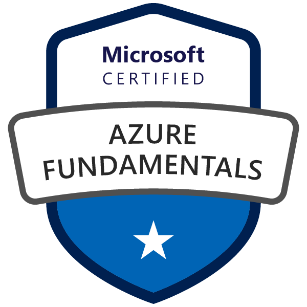
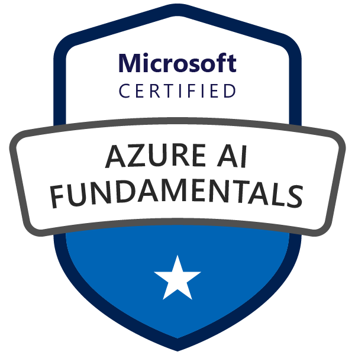
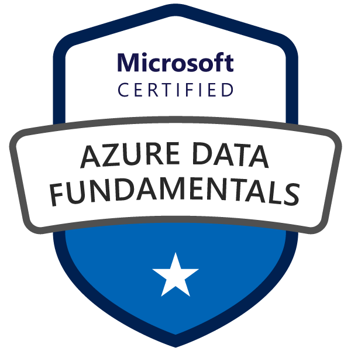
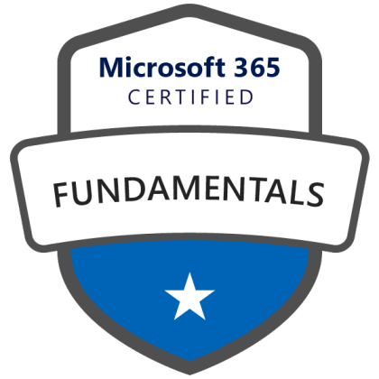
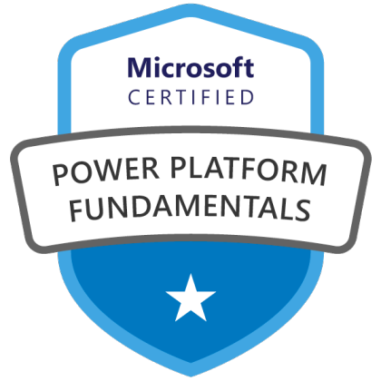
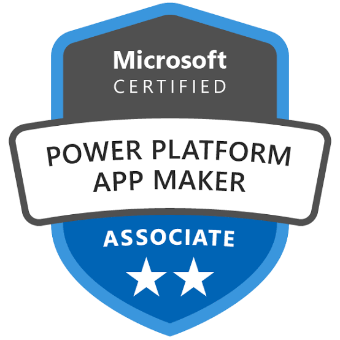
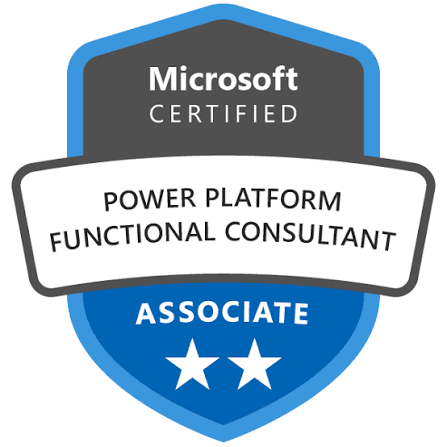
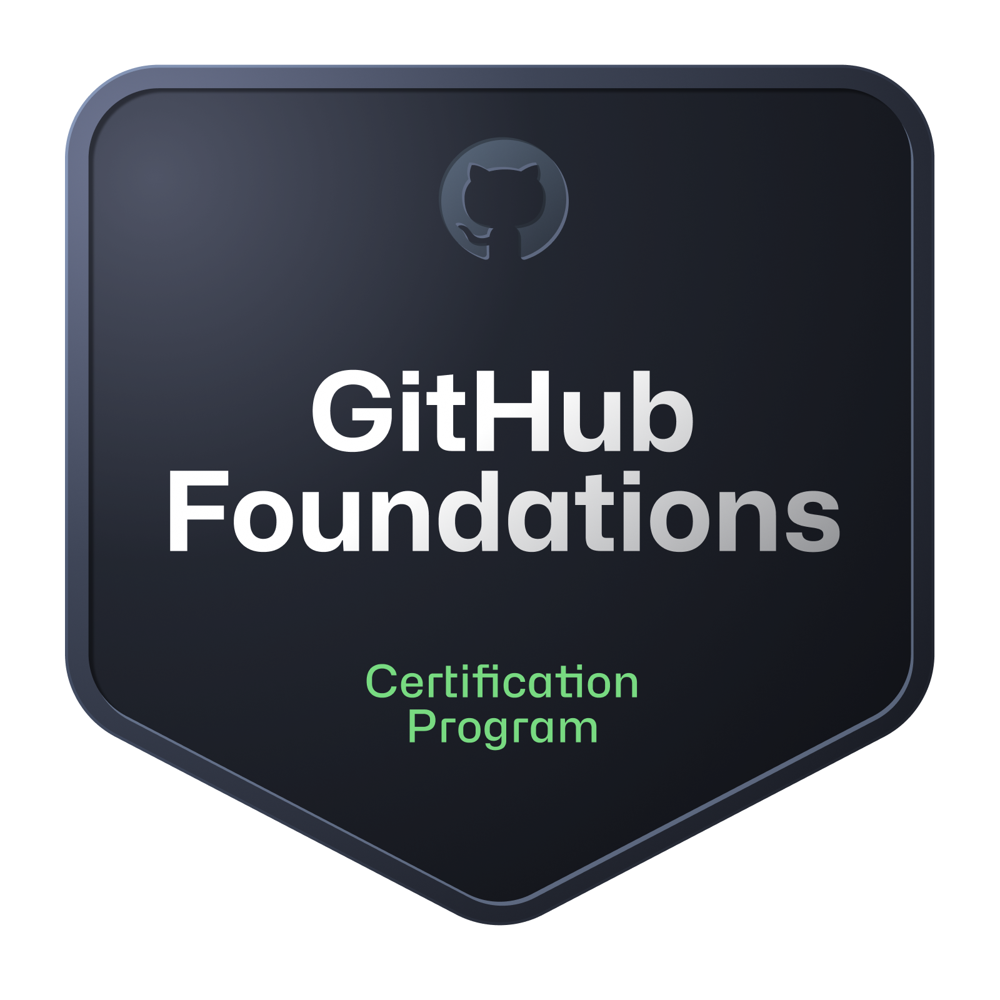
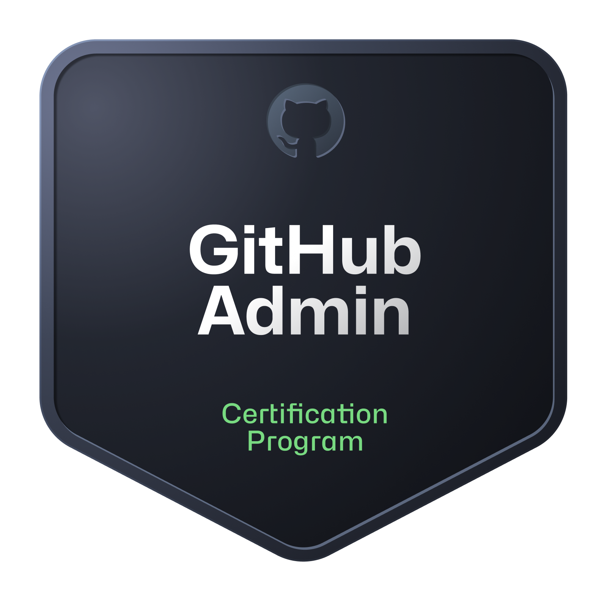
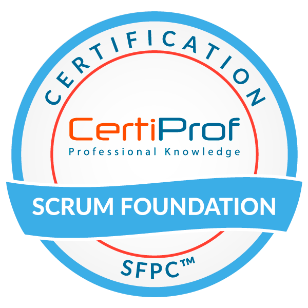

# 👋 Olá, eu sou Sara Lyma

**Software Engineer @ Avanade | Desenvolvedora Java | 14x Microsoft & GitHub Certified**

  
  

---

### 🚀 Sobre Mim

Engenheira de Software (BSc) apaixonada por construir sistemas escaláveis, seguros e de alta performance. Atualmente, atuo como **Desenvolvedora Java na Avanade**, entregando soluções em microsserviços para projetos críticos no setor financeiro. 

Além da tecnologia, sou formada em Ciências Contábeis com especialização em tributos e demonstrações contábeis. Essa vivência de mais de 10 anos na área financeira me traz uma visão de negócio apurada e estratégica em relação às necessidades reais do cliente. 

Atuo na interseção entre engenharia de software rigorosa e execução ágil, ajudando a modernizar ambientes complexos com código limpo, arquiteturas resilientes e automação inteligente.

### 🎯 Principais Áreas de Atuação

-   **Backend & Arquitetura:** Domínio em Java (17/21) e Spring Boot, com forte aplicação de Arquitetura Hexagonal e Microsserviços.
-   **Mensageria & Integração:** Construção de REST APIs robustas e comunicação assíncrona (RabbitMQ).
-   **Cloud & DevOps:** Pipeline de CI/CD, conteinerização e orquestração (Docker, GitHub Actions, ArgoCD, SonarQube).
-   **Ecossistema Multi-Linguagem:** Flexibilidade e experiência prática com C#, NestJS, Kotlin, JavaScript e React.

### 💡 Perfil

Movida pela curiosidade técnica e por resolver problemas complexos através da tecnologia. Fora do ambiente corporativo, sou ávida leitora de *hard sci-fi* e fantasia épica e cultivo árvores frutíferas na minha casa. 
Ultimo livro lido : "Devadorores de estrelas -Project Hail Mary-Andy Weir
                    "Perdido em MArte "  - Andy Weir 
                    
Também me dedico ao desenvolvimento de jogos (Godot Engine), já tendo colaborado em projetos de games em parceria com outros desenvolvedores. Meu objetivo é sempre unir engenharia sólida, criatividade e impacto real no negócio.
Sou esposa e mãe orgulhosa de 4 filhos , a eles eu dedico todo o meu trabalho . "Eu sei que voces vão longe ...."

---

### 🏆 Certificações

*Microsoft Cloud, Security & Data*

  
  
  
  
  
  

*Microsoft Power Platform & Dynamics*

  
  
  

*GitHub & Agile*

  
  
  
  
  

